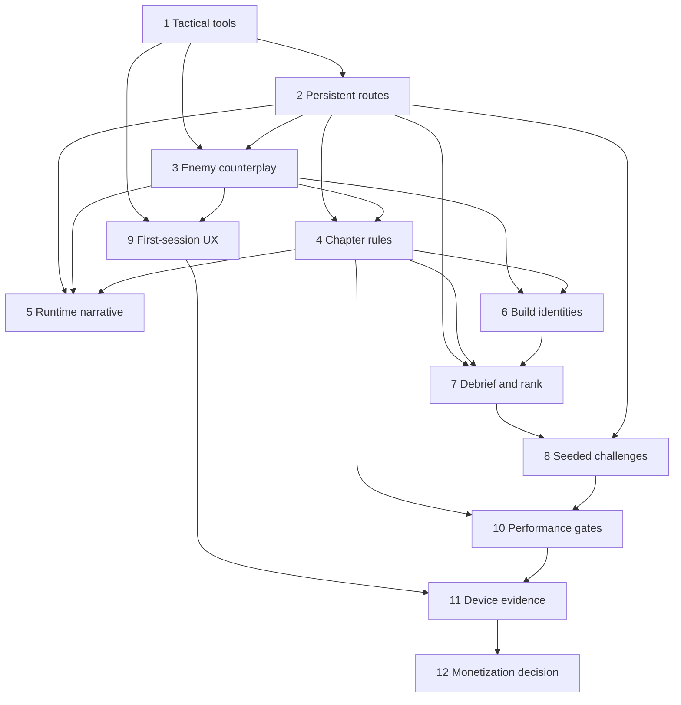

# BLACK WAKE — MASTER PRODUCT DESIGN

Design revision: 2026-10-10. This document defines the intended end state for the native Android game. It is a design forecast and coordination map. [PHASE_1_DESIGN_SPEC.md](PHASE_1_DESIGN_SPEC.md) is the **only implementation-authoritative contract** for GLM now.

## Authority and evidence states

- **LOCKED_FOR_GLM:** Phase 1 rules in the Phase 1 spec. Design authority only; implementation has not passed review.
- **PROVISIONAL:** A specific intended direction for Phases 2–10. Values, content, and rules must be revised after each upstream evidence review before becoming a GLM contract.
- **EVIDENCE_DEPENDENT:** Phase 11 validation protocol and any conclusion about retention, duration, readability, and device performance. A protocol may be planned; results cannot be assumed.
- **PENDING_DEVICE:** Any device-dependent UX threshold, thumb reach, haptic strength, audio mix, frame pacing, or session metric until physically observed.
- **MONETIZATION_LOCKED:** Phase 12 is a conceptual boundary only. No implementation, store placement, ad SDK, billing integration, or economy tuning for revenue is authorized before Phase 11 passes.

The Phase 1 spec was written before this master pass. It remains the sole coding authority; if this document appears to conflict with it, Phase 1 wins and the forecast must be corrected during gate review. Later docs are linked forecasts: [system matrix](SYSTEM_INTERACTION_MATRIX.md), [routes and chapters](ROUTE_AND_CHAPTER_BLUEPRINT.md), [enemy counterplay](ENEMY_COUNTERPLAY_MATRIX.md), [progression and retention](PROGRESSION_AND_RETENTION_MODEL.md), [exploit register](MASTER_EXPLOIT_REGISTER.md), and [acceptance gates](MASTER_ACCEPTANCE_GATES.md).

## Product thesis and final player loop

Black Wake is a short, replayable nautical pursuit game about carrying evidence through hostile water. The player reads three lanes, manages acoustic visibility, chooses how much proof to risk retrieving, and escapes a hunt whose behavior changes with the route and the tools used. The point of a run is a sequence of informed trade-offs, not survival by reflex alone.

| Transition | Player motivation and decision |
| --- | --- |
| Menu → mission/challenge | Continue Elias and Maya's dossier, improve a visible mastery target, or attempt a shareable seeded operation. The screen shows the next meaningful objective, not a list of currencies. |
| Mission → build/loadout | Choose two behavior cards and one vessel for the route threat. The selected combination makes at least one decision easier and another riskier. No purchased stat advantage is required. |
| Build → briefing | Learn the operation's Intel threshold, known route clues, likely enemy, and extraction condition. Unknowns remain to discover with Sonar/navigation. |
| Briefing → route entry | Commit to initial sea approach. The first branch previews risk and reward; later branch consequences persist through at least two sectors. |
| Navigation → risk/Intel | Steer between danger and evidence. Slow travel lowers signature but costs exposure time; Push buys distance while broadcasting position. Intel above the safe threshold tempts the player only when it creates a mastery or story choice. |
| Risk → pursuit escalation | Detection, tool noise, environment, and route history attract specific enemies. The player reads an archetype and responds with lane change, silence, Dive, Push, Flare, or a deliberate combination. |
| Pursuit → route consequence | Earlier branch changes geometry, enemy mix, Intel access, and Maya's information. Escaping the current pursuer does not erase the selected route. |
| Route → extraction | A chapter-specific final objective converts collected evidence into secured evidence. A final risk choice can improve rank without making bare completion impossible. |
| Extraction → debrief | Show the exact rank components, route, lost/secured Intel, best and worst decisions, and one actionable retry target. Failure identifies the avoidable turning point. |
| Debrief → retry/alternate route/next | Retry the same situation for mastery, try a different route/build to see its consequence, or advance story. New content is earned by achievement, not waiting. |

## The first 30 seconds

**0–8 s:** Elias enters dark water with one visible Intel case and one obstacle in different lanes. The player steers toward evidence. A nearby patrol searchlight sweeps the lane, so the case is tempting rather than free. Sound conveys a low engine thrum and distant radio chatter; the wake visibly widens as throttle rises.

**8–18 s:** A patrol begins to localize the wake. The player can slow to reduce signature, Push through a narrowing gap, or Dive under the visible boat at oxygen cost. A short Maya line reacts to the chosen behavior and gives useful information, never a lecture. The Intel case remains recoverable by a risky lateral move.

**18–30 s:** A fork preview shows a quiet passage with poor visibility and an exposed passage with more evidence. One manual Sonar ping can resolve a lane ambiguity but raises signature enough to matter. The player commits while the patrol reacts to the noise. The audio mix shifts from low motor pulse to a clear pursuit motif; the sonar ring, wake, and searchlight make the cause legible.

The identity is the linked choice: evidence versus concealment, information versus acoustic exposure, and speed versus future vulnerability. The exact opening sequence is **PROVISIONAL** until Phase 9 and device observation; Phase 1 only establishes the underlying controls.

## Twelve-phase connected design

| Phase / status | Intended player change | Upstream input | Downstream dependency / redesign trigger |
| --- | --- | --- | --- |
| **1 Core tools — LOCKED_FOR_GLM** | Push, Flare, Repair, Sonar each have good and bad timing, visible costs, enemy interaction. | Current simulation and HUD audit. | Routes and enemies must create situations where each tool is wrong. Redesign if traces show a tool is never chosen or universally best. |
| **2 Routes — PROVISIONAL** | Choose 2–3 persistent paths/chapter. Branch changes at least two later sectors, threats, Intel access, and extraction approach. | Tool timing and reach from Phase 1. | Enemy encounters, radio reactions, rankings and challenge seeds need route IDs. Redesign if branch choice reduces to a pickup or has an obvious best path. |
| **3 Enemy identity — PROVISIONAL** | Six archetypes demand different responses with telegraph and vulnerability. | Tool effects and route geometry. | Chapter composition, builds, tutorial and debrief mistakes depend on enemy counterplay. Redesign if one tool beats all six. |
| **4 Chapter identity — PROVISIONAL** | Eight operations each change a navigation or extraction rule. | Routes and enemy mixes. | Narrative triggers, rank parity, challenge fairness and duration depend on these rules. Redesign if a tester cannot identify a chapter from play behavior. |
| **5 Runtime narrative — PROVISIONAL** | Maya gives sparse, actionable reactions to chosen route, detection, damage, enemy and extraction. | Stable route IDs, enemy states, chapter mechanics. | Debrief acknowledges consequences; audio mix needs priority. Redesign if chatter obscures warning or lines claim events that did not occur. |
| **6 Progression — PROVISIONAL** | Three viable behavior identities, two equipped cards, free between-run respec; no universal best loadout. | Stable enemy/route threats and tool costs. | Rank fairness and challenge rules must know loadout. Redesign if an unlock is mandatory or a starter cannot clear campaign. |
| **7 Debrief/rank — PROVISIONAL** | Transparent S/A/B/C for completions, explicit failed-run retry target. | Intel security, route, tool use, extraction outcome. | Mastery goals and challenge score inherit the same event record. Redesign if rank rewards avoidance of gameplay or can be bought. |
| **8 Seeded challenges — PROVISIONAL** | Daily and shareable offline operations reuse eight chapters fairly. | Deterministic routes, enemy tables, rank event log, build baseline. | Retention evidence and later optional reward placements. Redesign if a seed can be rerolled for an easier score or yields impossible spawn patterns. |
| **9 First-session UX — PROVISIONAL / PENDING_DEVICE** | Action-gated teaching and HUD that prioritizes steer/survive/danger. | Final control count, actual enemy telegraphs and tool feedback. | Device understanding and 30-second identity. Redesign on thumb obstruction or accidental tactical taps. |
| **10 Performance — PROVISIONAL / PENDING_DEVICE** | Pursuit, audio, and controls remain responsive on target devices. | Dense enemy/route/challenge scenarios. | Device session validity. Redesign effects/layout if readability or frame pacing fails despite technical optimization. |
| **11 Device validation — EVIDENCE_DEPENDENT** | Observe real 10/30/60-minute sessions and voluntary replay. | Implemented and internally gated Phases 1–10. | Product release judgment and monetization gate. Redesign earlier systems if players cannot explain choices or repeatedly use one policy. |
| **12 Monetization — MONETIZATION_LOCKED** | Optional support after engagement, never in-run pressure. | Phase 11 evidence and local policy/store review at that time. | Commercial test only. No implementation until Phase 11 PASS; remove any placement that changes rank, fairness, or retry intent. |

## Dependency graph and change control

Gate sequence: GLM implements only Phase 1 → GPT Design reviews raw behavior and runtime evidence → return one of `PASS`, `PASS_WITH_FOLLOWUPS`, `FAIL_IMPLEMENTATION`, `FAIL_DESIGN`, `INSUFFICIENT_EVIDENCE` → update this design and linked forecasts with observed facts → lock Phase 2 and issue its separate contract. Repeat phase by phase. A PASS_WITH_FOLLOWUPS cannot conceal a failed core gate. Phase 11 needs real device logs and player observations; a simulator cannot substitute.

## Intended content scale, subject to evidence

Eight existing chapters remain the target. Each should offer **2–3 meaningful routes**; target 20–22 authored route variants across the campaign, where shared assets can be reused but graph, encounters and constraints differ. Target **5–7 minutes per completed chapter**, with a short early chapter closer to four minutes. Target **70–100 minutes to first campaign completion** including some retries; **4–6 hours of voluntary mastery/replay** for interested players. These are design targets, not observed metrics. Remove dead travel before lengthening sectors.

Target **six enemy archetypes**, with at least **12 tested two-archetype encounter combinations** across campaign/challenges; target **three viable build identities** from two-slot behavior cards. The challenge generator should initially support **at least 12 legal modifier pairs × eight chapters × 20 verified seeds = 1,920 addressable operations**, not claim infinite handcrafted content. Only verified fair seeds enter the daily rotation. Every added minute must contain a route, threat, Intel or tool decision.

## Key global constraints

1. Every source of information has a cost or a limitation. Sonar reveals current contacts; briefing provides partial prior knowledge; Maya reacts to observed facts, not omniscience.
2. Every speed choice changes both time to a decision and exposure. Low throttle cannot be universally safe; routes and enemies create positional or timed pressure without arbitrary countdown spam.
3. Intel has separate meanings: **recovered** during a run, **secured** at extraction, and **Evidence Credits** awarded once for distinct mastery achievements. The meta economy never pays per endlessly repeated pickup.
4. Every ability has an enemy/environment response visible enough to learn. Losing must suggest one concrete correction.
5. Run results are reproducible by chapter, route, build, seed, modifier set, and rules version. Random spawns must pass fairness checks before score eligibility.
6. Store systems never influence damage, rank, available tools, route choice, Evidence Credits, or challenge score.

## Immediate handoff rule

Only [PHASE_1_DESIGN_SPEC.md](PHASE_1_DESIGN_SPEC.md) may be handed to GLM now. This master pass authorizes no gameplay implementation of Phases 2–12. The next design act after GLM returns is to review Phase 1 evidence and either reject it or revise and lock Phase 2.

## End-of-pass status register

| Phase | Status |
| --- | --- |
| 1 — Core surgery | **LOCKED_FOR_GLM** |
| 2 — Real routes | **PROVISIONAL** |
| 3 — Enemy identity | **PROVISIONAL** |
| 4 — Chapter identity | **PROVISIONAL** |
| 5 — Runtime narrative | **PROVISIONAL** |
| 6 — Progression | **PROVISIONAL** |
| 7 — Debrief and ranking | **PROVISIONAL** |
| 8 — Retention challenges | **PROVISIONAL** |
| 9 — First-session UX | **PROVISIONAL**; device usability **PENDING_DEVICE** |
| 10 — Performance | **PROVISIONAL**; thresholds **PENDING_DEVICE** |
| 11 — Device validation | **EVIDENCE_DEPENDENT**; observations **PENDING_DEVICE** |
| 12 — Monetization | **MONETIZATION_LOCKED** |
